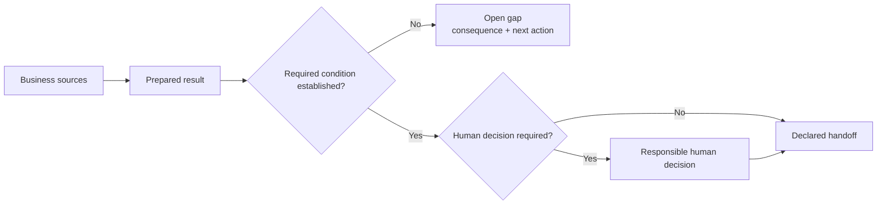

# IMPACTS Protocol

**Keep sources, required checks, executed checks and responsible decisions inspectable in ordinary files.**

IMPACTS is a file-based method for people and file-capable agents. Starting from existing business files, it designs work backwards from the needed result: it removes unneeded work, makes needed knowledge available where work happens, and coordinates contributions from people, code and AI with explicit checks. For bounded work whose steps can be declared in advance, its optional Core binds selected [Vorgänge](02_protocol/ontology.md#protocol-vocabulary) to versioned definitions and declared inputs; the Python CLI supplies templates, structural validation and hashing. Validation and execution follow the [Core boundary](02_protocol/ontology.md#enforcement-and-completion). IMPACTS does not authenticate people, grant permissions or detect a coordinated rewrite of content and its recorded digest. A `human:<id>` value records attribution; it does not authenticate a person or establish approval.

[Prepare a useful offer draft](FIRST-WIN.md) · [Agent start](#version-and-entry-points) · [Install or validate](#optional-technical-use) · [Trust and security](#trust-and-security-boundaries) · [Deutsch](02_protocol/translations/readme.de.md)

**First result, no installation:** prepare an internal offer draft with source links, open price and delivery questions, and a named next action. The supplied exercise is synthetic and authorizes no customer commitment.

Agents may interpret and draft. Required calculations need executed deterministic checks. Human decisions remain human. Missing facts remain open. Validation, hashes and Git history establish only their named technical conditions; they do not establish business acceptance or permission.

> **Agent start:** Resolve the [protocol version and source](#version-and-entry-points), read [CONTEXT.md](CONTEXT.md), and follow one selected route. Keep customer material in its customer workspace.

## Relationship to ICM

ICM supplies the technical foundation: folder-directed context, plain-file structure and inspectable agent wiring. IMPACTS builds methodically on those principles at the business layer: a first-principles method for understanding a company and connecting its sources, work, checks, calculations and human decisions. The acronym ICM is also used for personal folder systems; that usage is separate and does not define IMPACTS. This relationship requires neither an ICM installation nor one shared folder.

IMPACTS is not a personal mega-folder for everything. Customer work remains in each customer's repository or workspace; the protocol Core stays small and holds only typed contracts for bounded work with declared steps.

## Follow your task

| You have… | Start here | First completion |
|---|---|---|
| An offer to clarify | [First contribution](FIRST-WIN.md) | Internal draft, source links, explicit gaps and next action |
| Notes or an undocumented business | [Form selection](02_protocol/impacts-architect/references/formwahl.md) | Smallest suitable existing home for facts and open questions |
| Existing repositories or a shared source change | [Architect Restructure mode](02_protocol/impacts-architect/SKILL.md#restructure-mode) | Owners, revisions, consumers, migration and recovery made explicit |
| A bounded result whose steps can be declared | [Form selection, then Build mode](02_protocol/impacts-architect/SKILL.md#form-selection) | Candidate definition with result, inputs, checks and routes |
| An existing bound Vorgang | Its `vorgaenge/<vorgang>/CONTEXT.md` and linked inputs | Next permitted action or a specific blocker under the bound revision |
| Several cases or Vorgänge to survey: pending work, resource use, capacity or ordering | [Cross-case route](02_protocol/CONTEXT.md#task-routes) | Derived overview with sources, coverage and open points; permitted next work kept apart from actual execution |
| A calculation to check | [Computation example](06_evaluations/computation-walk/CONTEXT.md) | Conditional result or focused missing-input question |



This diagram is orientation. The [ontology](02_protocol/ontology.md) owns evidence and valid inference; the [Capability contract](02_protocol/capabilities.md) owns reusable operations; [Binding and execution](02_protocol/binding.md) owns source binding, handoffs and execution controls.

## Get the protocol

Edition v0.4.0. Once published, use the published immutable Release [v0.4.0](https://github.com/Melvinanalytics/impacts-protokoll/releases/tag/v0.4.0) for new work. Download the wheel, complete source archive and `SHA256SUMS`; verify every listed checksum before installing or using the source archive.

Keep the complete source together: method, Architect, references, templates and examples. Reading the archive needs no installation. A copied Architect folder is incomplete even when its `references/` folder is present: it also depends on parent protocol files and root guidance. The wheel contains the CLI, static Viewer HTML resource, schemas and templates; it does not contain the method, Architect, evaluations, tests or complete source guidance. Wheel users who need the source-provenance form can run `impacts template herkunft` (or add `--language de`). That template has nine evidence fields. Its field count describes this template; it is not a universal line-count rule.

## Version and entry points

The source edition is `[project].version` in the root [pyproject.toml](pyproject.toml). Run `impacts --version` for package metadata identity, or `python -m pip show impacts-protocol` in the Python environment that supplies `impacts`. Without installed metadata, the CLI labels a source `pyproject.toml` fallback or reports an unknown version. Published package version `X` corresponds to release tag `vX`. Metadata identifies an edition; it does not prove the loaded code's bytes, an exact source revision or compatibility. In particular, a modified editable install or a source checkout shadowing another installation still needs its actual source identity recorded.

Record the actual source location and identity in the existing root `CONTEXT.md` of every repository that applies the protocol: a customer workspace or a Fachrepo, which maintains a domain's rules, calculations, Capabilities or Hauptprozesse for reuse in other repositories. A tool that an Arbeitsschritt only calls does not apply the protocol. In a Git checkout, use `git rev-parse HEAD` and `git status --short` to record the commit and any local changes; retain a release tag only when it identifies that source. Without Git, record the archive's actual origin, tag or filename and local source location; retain an available checksum and describe local changes. An archive filename alone is not proof of its contents. Keep unavailable identity or conflicting versions explicit; obtain the corresponding source before applying a rule whose version cannot be resolved. A checkout beyond a release or modified files must be identified as such, even if the edition in `pyproject.toml` is unchanged.

| Starting surface | Entry and completion |
|---|---|
| Complete protocol source | Read this protocol's root [CONTEXT.md](CONTEXT.md), then the selected task route. Keep customer work in its own folder. |
| New or existing customer folder | Read that folder's `CONTEXT.md`; record or follow its actual protocol source/revision and working language. Resolve `02_protocol/` paths against that source. |
| Existing Core Vorgang | Start at its `vorgaenge/<vorgang>/CONTEXT.md` and declared inputs. Preserve its bound Hauptprozess, sources and language; a newer installed package or protocol does not upgrade them. |
| Wheel or copied skill with missing source | Recover the source/revision from provenance: published versions from [releases](https://github.com/Melvinanalytics/impacts-protokoll/releases), unreleased revisions from the recorded original repository or file snapshot. Resolve the needed links there before applying their rules. |

Entry is resolved when the task's router, source identity and required links are reachable without substituting `main`, another release or model memory. If something is missing, retain the gap and next action; independent permitted preparation can continue. Changes to existing definitions follow [Reviewed correction](02_protocol/impacts-method.md#reviewed-correction), while earlier bound work retains its revisions.

The [root router](CONTEXT.md) locates authorities; knowledge and records keep their homes. English owns the protocol. German customer work stays German: [operator guide](02_protocol/translations/readme.de.md) · [language contract](02_protocol/language.md).

### Breaking changes from v0.3

- Validator text output now starts with a status line.
- An `ablage` reference must name a store declared on an `Ablage: <name> ...` line in the workspace root router body; an undeclared store fails ([snapshot and provenance](02_protocol/binding.md#snapshot-and-provenance)).
- Use `hauptprozesse/` and `hauptprozess_revision`; the retired collection, revision field and `application` template kind are no longer accepted ([vocabulary](02_protocol/ontology.md#protocol-vocabulary)). Definition IDs omit any two-digit display prefix ([tree rules](02_protocol/binding.md#hauptprozess-tree-rules)).
- Workspace and Vorgang `protocol` pins are required for new work; a Vorgang newer than its workspace pin fails ([snapshot and provenance](02_protocol/binding.md#snapshot-and-provenance)).
- Existing v0.3 work does not fail. A Vorgang without `protocol` that still carries `eingabe_hash` in its `laufpfad`, and any workspace or Vorgang recording another major.minor, is reported as not judged, which is not a failure. A new Vorgang without `protocol` fails with `protocol pin missing; add protocol: <release> to the frontmatter` ([snapshot and provenance](02_protocol/binding.md#snapshot-and-provenance)). A definition tree moved into `hauptprozesse/` is judged under v0.4 and must drop `stufen`.
- Issue codes are renamed into the families `structure.*`, `binding.*` and `execution.*`; `run.invalid`, `hash.mismatch`, `revision.invalid`, `reference.duplicate` and the general `structure.invalid` no longer exist. Anything that matches on a code must be updated ([issue codes](02_protocol/binding.md#validation-issue-codes)).
- Attempts use `nummer`, `gelesen` and `geschrieben` file references with per-file digests. Every declared input slot must be covered before opening; completed outputs require a complete inventory. Attempts contain only `output/`; mutable captures and provenance use flat `_quellen/` ([snapshot and provenance](02_protocol/binding.md#snapshot-and-provenance)).
- Source commits and Hauptprozess trees must be reachable from branch, tag, remote-tracking history or resolvable HEAD; orphan, stash-only and auxiliary-ref-only history does not qualify. Bound trees must occur under `hauptprozesse/` ([snapshot and provenance](02_protocol/binding.md#snapshot-and-provenance)).
- `ablage` references cannot represent workspace or Git files; external bytes remain harness-verified. Validate JSON requires `external_references_not_verified`; CLI reports use format 3, hash results contain per-file references, and viewer exports use `impacts-view/5` ([reference boundary](02_protocol/binding.md#snapshot-and-provenance)).
- Handoffs name the consumer input slot as `arbeitsschritt:<slug>:<slot>` and bind a completed producer's output directly ([handoff](02_protocol/binding.md#visible-output-and-handoff)).
- Execution progress derives from `laufpfad`; `stufen` is rejected and business stage belongs to the subject record. Owner stopping uses `abgebrochen` with attributed decision output; routed ends retain `beendet` ([progress](02_protocol/binding.md#vorgang-progress), [records](02_protocol/binding.md#record-writeback)).
- A restart names at most one continuing predecessor through `vorgaenger`; owner-stopped or ended Vorgänge cannot continue, and one predecessor has at most one judged successor ([execution](02_protocol/binding.md#execution)).
- The harness sets `status_seit` and commits the Vorgang file at every transition; Core does not check this, and `status_seit` stays optional in the schema ([execution](02_protocol/binding.md#execution)).
- Core checks a `wartend` attempt for `wiedereinstieg` with `ausloeser` and a `continuation_ref` that is an existing workspace-relative regular file. The harness records that the request was sent or the outside event began, and the next check in `wiedereinstieg.faellig`; Core checks neither. An unsent request, including after a protocol break, stays `aktiv` ([waits](02_protocol/binding.md#waits)). Returning steps declare a readable `Loop bound:` ([loops](02_protocol/binding.md#loops)).
- Imports require source identity and tree records outside the copied tree; takeover uses reviewed replacement from empty staging, preserving existing Vorgang bindings ([Scale](02_protocol/impacts-method.md#scale)).
- Before binding a deterministic code or Capability revision, replay a closed attempt's retained inputs and compare the recorded output digest ([Test](02_protocol/impacts-method.md#test)).

## Trust and security boundaries

IMPACTS defines file contracts and authority boundaries. The selected execution environment remains responsible for access, credentials, isolation, retention and external effects.

| Concern | Boundary |
|---|---|
| Customer material | Keep it in the customer repository or workspace. Public examples and evaluations are synthetic. |
| Access and credentials | The configured harness supplies them outside Arbeitsschritt files; availability does not grant permission. |
| Instruction and data boundary | Only the harness's declared, reviewed instruction surfaces may guide processing. Business source content and tool responses are untrusted data; neither they nor instruction files can expand configured permissions, routes or authority. |
| Human decisions | Agents do not create human decisions. A `human:<id>` value records attribution; it does not authenticate anyone. |
| Validation | Apply the [Core boundary](02_protocol/ontology.md#enforcement-and-completion) to `impacts validate`; hashes and Git establish only their named byte or history conditions. |
| External writes | A write is a separately permitted effect with a target, scope, authority, current-state check and confirmation evidence. |
| Execution | Under the [Core boundary](02_protocol/ontology.md#enforcement-and-completion), a configured harness must support the selected operations, checks, handoffs and human boundaries. |

Authorities: [Arbeitsschritt processing](02_protocol/templates/arbeitsschritt.md#processing) · [enforcement and completion](02_protocol/ontology.md#enforcement-and-completion) · [human gates](02_protocol/binding.md#signals-and-human-gates) · [record writeback](02_protocol/binding.md#record-writeback)

## Optional technical use

| Mode | Obtain | Requires | Boundary |
|---|---|---|---|
| Knowledge only | Complete tagged source retained as evidence, plus its reviewed text-only projection | Text editor or managed knowledge source | No code execution or automatic adoption of embedded instructions; retain source paths and release identity |
| Read-only source use | Complete tagged source | Person or permitted file-capable agent | Review harness-recognized instruction files before use; other retrieved content grants no permission or action authority |
| Local CLI | Complete tagged source or verified release wheel | Python 3.11+ in an isolated environment | `init`, `template`, `validate`, `hash` and `view`; no Arbeitsschritt execution |
| Executable action | Customer workspace and separately reviewed harness or service | Actual sources, permissions, operations and checks | Deployment-specific runtime and authority; least privilege and explicit effects |

Call machine validation for a needed check when a suitable checker is available. An unavailable or failed check leaves its condition unestablished: preparation continues while the dependent claim or action waits. Explain progress, consequence and next action; retain raw diagnostics for maintainers. [Tooling stop](02_protocol/impacts-architect/references/formwahl.md#tooling-stop) owns this boundary.

The CLI supplies `init`, `template`, `validate`, `hash` and `view`. Validating a Hauptprozess without a Vorgang checks Core structure, as [Enforcement and completion](02_protocol/ontology.md#enforcement-and-completion) bounds it, without Git. Vorgang validation needs Git and committed Hauptprozess binding. [Snapshot and provenance](02_protocol/binding.md#snapshot-and-provenance) states the supported history references. Stable interfaces are the CLI, `impacts view --json` with its `format`, the names in `impacts_protocol.__all__` and `impacts_protocol.view.site_model`, which returns that export in process. `site_model(workspace, vorgaenge=...)` takes a collection of slugs, validates the workspace once and builds only those Vorgang pages; overview, Hauptprozess and Ist-Prozess pages are left out. Each page equals the page of the same name in `site_model(workspace)`. Validation still reads the whole workspace; only the selected Vorgang folders are captured and read as pages. A slug that names no entry in `vorgaenge/` raises `ValueError`; one string instead of a collection raises `TypeError`. Other modules may change in any edition; a repository that imports them runs its own tests before changing its pin.

For the CLI, use Python 3.11+. In your chosen working folder, create and activate a virtual environment (shown for macOS/Linux):

```bash
python3 -m venv .venv
source .venv/bin/activate
```

Choose one installation source:

- **Complete checkout:** once published, use the source tree extracted from the published immutable v0.4.0 Release after every listed `SHA256SUMS` entry passes. From the verified tree's root, run `python -m pip install -e .`.
- **Release wheel:** once published, download the wheel, complete source archive and `SHA256SUMS` from the published immutable Release [v0.4.0](https://github.com/Melvinanalytics/impacts-protokoll/releases/tag/v0.4.0) into one folder. Verify every listed asset with `shasum -a 256 -c SHA256SUMS` (macOS/Linux), then install with `python -m pip install ./impacts_protocol-0.4.0-py3-none-any.whl`.

Follow [Version and entry points](#version-and-entry-points) to identify the installed package and obtain its complete source. Then, outside the intended new customer folder:

```bash
impacts init ../impacts-demo
impacts validate ../impacts-demo
impacts template arbeitsschritt
impacts template herkunft
```

`init` creates an empty Core workspace (`.gitattributes`, `CONTEXT.md`, `hauptprozesse/`, `vorgaenge/`), writes exactly `* -text` plus a newline to `.gitattributes`, refuses an existing target and creates no Git repository or runnable process. Existing workspaces need the same line before their first bound Vorgang. Keep the customer workspace separate from the protocol source. Add `--language de` to `init` or `template` for German. Initialize Git at the Core root before committing a Hauptprozess for Vorgang binding.

Explore the [Hauptprozess template](02_protocol/templates/hauptprozess.md), [schemas](02_protocol/schemas/), [Capabilities](02_protocol/capabilities.md) and [Architect skill](02_protocol/impacts-architect/SKILL.md). The programmed [offer walk](06_evaluations/offer-walk/CONTEXT.md) retains checked synthetic preparation at a pending human gate; the [cold walk](06_evaluations/cold-walk/CONTEXT.md) exercises loops, waits, synthetic gates and transport.

### Read-only view

`impacts view <source> --out <folder>` writes static HTML pages for a workspace, one Hauptprozess or one Vorgang (`vorgaenge/<slug>/CONTEXT.md`). Workspace and Vorgang views require a Git-root workspace; a single Hauptprozess can be viewed without Git. The output folder must not exist yet. Add `--json` to also write `model.json`, an export and never a source. Generate a new folder after the files change.

- **Shows:** the route map from Hauptprozess through Teilprozess to Arbeitsschritt; for each Arbeitsschritt its job, authority, flow and [executors](02_protocol/impacts-architect/references/zuschnitt.md#automation-boundary); for each Vorgang its position, status, stage when declared and Leistung achievement under the [Progress derivation table](02_protocol/binding.md#vorgang-progress), with its recorded status start and next check shown verbatim; on the workspace overview a data model card read from the packaged schemas, with each file kind's required and optional fields, what they refer to and how many such files the workspace shows; for each Ist-Prozess its analysis table. Where the table's proposed moves name `arbeitsschritt:<slug>` or the code span `entfaellt`, as the [as-is template](02_protocol/impacts-architect/templates/ist-prozess.md) describes, the page lists today's activities beside their proposed target Arbeitsschritte. An Ist-Prozess without that table appears verbatim. Source controls show the captured section or parsed frontmatter with file, line and digest. Uncaptured Markdown targets remain explicit references; the viewer does not follow them.
- **Never:** it invents no value; a missing or ambiguous entry stays visible as a gap, and titles are never matched. It has no clock, so it judges no lateness. It decides, schedules, approves and changes nothing, and writes only the new folder. A target Arbeitsschritt on the page is a proposal; it proves neither coverage nor implementation.
- **Language:** page labels follow the `Working language` recorded in the workspace `CONTEXT.md`. Without that setting the pages are German unless `--language en` is passed; `init` and `template` default to English unless a language is explicitly selected; a `--language` that differs from the setting is refused.
- **Exit codes:** `0` when every selection is shown; `1` when some selections were refused and the pages show them as such, or when the source cannot be viewed, with the cause on stderr; `2` for invalid arguments.

### CLI output and text input

`impacts validate <path>` starts with a status line and prints issue code, path, message and rule link on failure. `impacts hash <root> <file-or-directory>...` prints per-file references as JSON on success; operational errors go to stderr. Human-readable message wording is diagnostic, not a stable parsing interface.

For agents and CI, add `--json` to `validate` or `hash`. A completed check writes one JSON object to stdout with `report_version: 3`, `command`, `tool` metadata and an `issues` list of `code`, `path`, diagnostic `message` and protocol heading link `rule`. Validation adds `root`, `valid`, `release` (the validator's), `pin` (the workspace's, or null), `judged` (counts of `hauptprozess`, `teilprozess`, `arbeitsschritt`, `vorgang` and `versuch`), `not_judged`, `not_judged_counts` (separate `vorgang` and `definition_tree` counts), `superseded` (Vorgang routers replaced by a successor), `external_references` (each a `vorgang` router path and a `pointer` such as `/laufpfad/0/gelesen/1`) and `external_references_not_verified` (their count); hashing adds `attempt`, `surfaces` and `references` (null on failure). Unknown metadata version is null. Argument errors occur before dispatch and retain stderr diagnostics with exit `2`; they do not produce a JSON report. `not_judged` contains each skipped router path and its recorded `protocol` value or null, with `reason` for excluded definition trees; skipped items are not issues. The report version identifies this output format, independently of the package edition and the customer's bound source revision.

`report_version: 3` protects the JSON report shape. Human-readable `message` values are diagnostic and may change. The frozen `cases.json` corpus defines the issue codes and results required for each listed case, within that corpus's structural scope; it is not an exhaustive list for every possible input. When a documented parsing or routing prerequisite fails, checks that depend on the unread definition may be suppressed, while independent defects remain reportable. Changing the report shape requires a `report_version` change and corresponding consumer and runner updates. Changing a required result for a frozen case requires a reviewed change to its fixture or expected result and fresh report evidence. No separate protocol-specification version is introduced for these case expectations.

```bash
impacts validate ../impacts-demo --json
impacts hash ../impacts-demo/vorgaenge/example/check/001 input --json
```

| Exit code | Meaning |
|---|---|
| `0` | The requested operation or structural validation succeeded. |
| `1` | Validation or an expected operation failed, including an invalid hash surface or an existing `init` target. |
| `2` | CLI arguments are invalid. |

A valid `wartend` entry or pending human gate is not a validation failure. Exit `0` establishes neither business completion nor approval. Issue codes such as `schema.invalid`, `binding.reference_digest` and `trust.invalid` distinguish failed checks within exit `1`.

The issue codes and their next actions are listed under [Validation issue codes](02_protocol/binding.md#validation-issue-codes).

Fix parse errors, documented routing prerequisites and unresolved route targets before interpreting absent graph diagnostics: dependent checks can be withheld when their definitions cannot be read. Independent defects remain reportable. Rerun validation after repair. A rejection does not imply that every independent defect has already been reported.

Markdown input accepts UTF-8 with one optional leading BOM and LF or CRLF line endings. Repeated leading BOMs are malformed input. Strict YAML ingestion rejects duplicate and non-string mapping keys; it retains the existing safe YAML scalar rules, so quote string values such as `NO`, `on` and `off`. BOMs, line endings and Unicode normalization can change a digest even when text looks the same ([hash rule](02_protocol/binding.md#snapshot-and-provenance)).

## Develop and contribute

Read [AGENTS.md](AGENTS.md) and the nearest `CONTEXT.md`; update rules at their existing homes.

```bash
python -m pip install -e ".[test]"
python -m pytest -q
python3 06_evaluations/complexity-budget/check.py
```

With uv, `uv run --frozen --extra test pytest -q` runs the same suite from the committed lock. The test extra supplies pytest, Hypothesis for generated boundary cases, and setuptools and pip for packaging tests using `--no-build-isolation`; these are not runtime dependencies. Run evaluations from their linked guides. Local checks cover Python 3.11/3.14 on macOS. The distribution supplies CLI, the static Viewer HTML resource, schemas and templates; use the complete checkout for method, Architect, examples and tests.

For the hash-enforced Linux dependency recipe, see [Bounded Linux dependency install](CONTRIBUTING.md#bounded-linux-dependency-install).

The public [structural conformance corpus](06_evaluations/conformance/CONTEXT.md) contains fixed synthetic cases and expected results. Its independent runner accepts a candidate command, so another implementation can exercise the same cases. The workflows run the manifest's cases on GitHub-hosted Windows and macOS with Python 3.12; unsupported filesystem cases are reported separately. This checks only those named runners and cases, not universal operating-system or filesystem support. The corpus covers a named structural subset, not all protocol meaning or production use. The [independent-implementation challenge](06_evaluations/conformance/CONTEXT.md#independent-implementation-challenge) requires work from the written contract, disclosure of prior source exposure and additional independently authored cases. A pass covers only the declared structural subset. For descriptive file-count measurements, use [benchmark_scale.py](tests/benchmark_scale.py); setup is excluded, each validation starts a fresh interpreter, and no timing limit or concurrency guarantee is asserted. Run `python tests/benchmark_scale.py --sizes 1000 10000 100000 --repetitions 3 --output scale-results.json` in the test environment. The report records every sample and source-file digest.

After a tagged release workflow passes and publishes, its release notes retain workflow-reported evidence: the source commit, tag, run and build attempt; test totals for Python 3.11 and 3.14; and exact Windows/macOS runner platforms, Python 3.12 runtime, corpus SHA-256, case count, passed count and unsupported cases with reasons. Reports must come from the same build attempt. This durable record describes those workflow runs and named inputs; it is not independent verification, a build attestation, publisher authentication or evidence for other environments. It does not replace a public third-party reproduction.

Submit [issues](https://github.com/Melvinanalytics/impacts-protokoll/issues) or [pull requests](https://github.com/Melvinanalytics/impacts-protokoll/pulls) with revision, expected/observed behavior and a synthetic case. Exclude private customer material; update affected German surfaces and report checks not performed. Tests, files-only consumer checks and release decisions are separate.

[Apache License 2.0](LICENSE).
