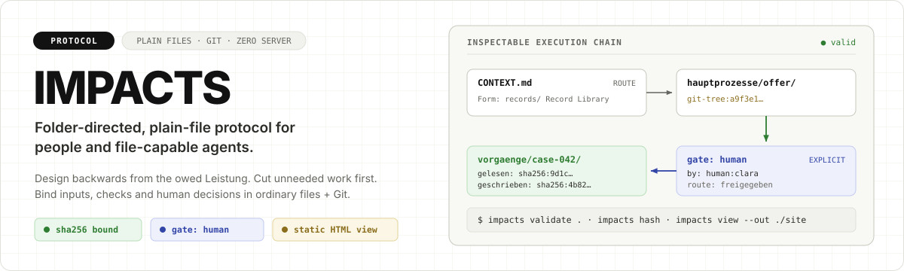
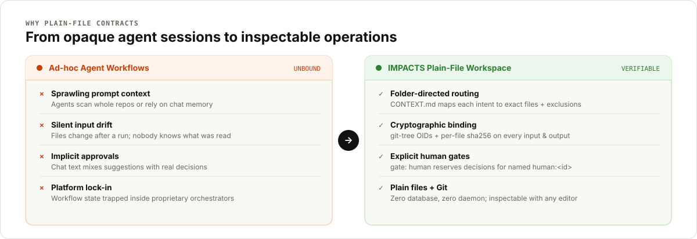
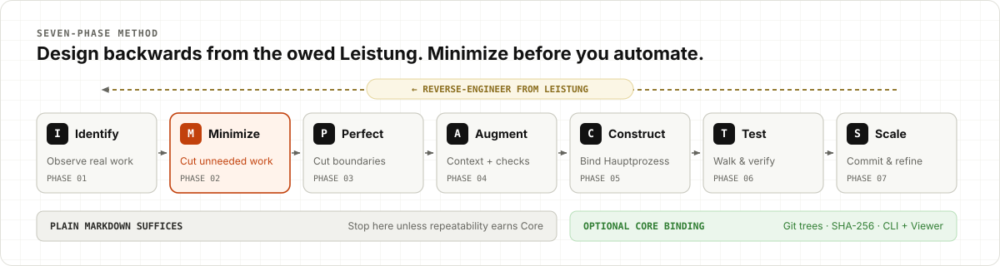
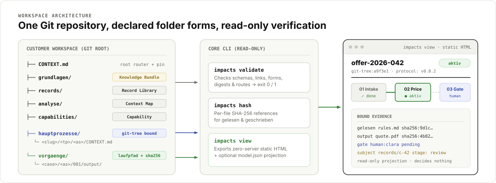
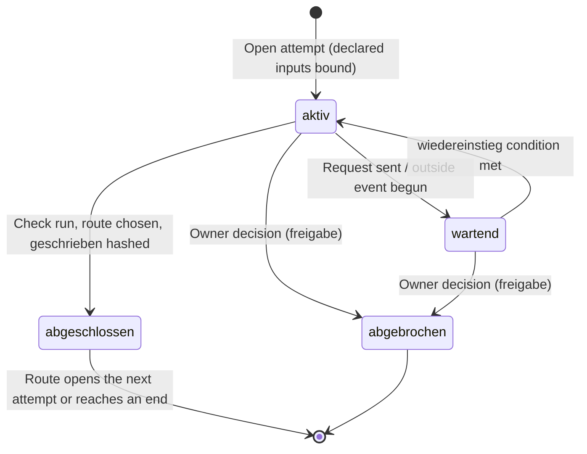

<p align="center">
  <picture>
    <source media="(prefers-color-scheme: dark)" srcset=".github/assets/hero-dark.svg">
    <source media="(prefers-color-scheme: light)" srcset=".github/assets/hero-light.svg">
    
  </picture>
</p>

<p align="center">
  <a href="#version-and-entry-points"></a>
  <a href="LICENSE"></a>
  
  
</p>

<p align="center">
  <strong>Keep sources, required checks, executed checks and human decisions inspectable in ordinary files.</strong><br>
  <a href="FIRST-WIN.md">First contribution (no install)</a> ·
  <a href="#version-and-entry-points">Agent start</a> ·
  <a href="#optional-technical-use">Install &amp; CLI</a> ·
  <a href="#trust-and-security-boundaries">Trust boundaries</a>
</p>

> **Agent start:** Resolve [Version and entry points](#version-and-entry-points), read [CONTEXT.md](CONTEXT.md), and follow one route. Keep customer work in its own repository; the Core stays small.

---

## Why IMPACTS

IMPACTS is a folder-directed, plain-file method for people and file-capable agents. Starting from existing business files, it designs work backwards from the needed result, removes unneeded work, and connects sources, checks, calculations and human decisions explicitly. Its optional Core binds repeatable [Vorgänge](02_protocol/ontology.md#protocol-vocabulary) to versioned definitions and declared inputs; the Python CLI supplies `init`, `template`, `validate`, `hash` and `view`.

<p align="center">
  <picture>
    <source media="(prefers-color-scheme: dark)" srcset=".github/assets/contrast-dark.svg">
    <source media="(prefers-color-scheme: light)" srcset=".github/assets/contrast-light.svg">
    
  </picture>
</p>

**IMPACTS bridges business clarity and agentic execution.** On the business side, form selection, ontology, and market topology help a company understand its own operations and translate them into clean domain objects and explicit obligations. On the AI side, the workspace works like Unix: plain files in and out, composable folders, explicit instructions, and verifiable checks in a clean harness. Both worlds meet in ordinary files and Git, bringing agentic operations within reach of any team without a workflow platform: **agents draft and structure, deterministic checks compute and verify, and people decide.**

**Grounded in open plain-file foundations:** Folder-directed routing is inspired by [ICM (arXiv:2603.16021)](https://arxiv.org/abs/2603.16021) and typed directory bundles by [OKF v0.2](https://github.com/GoogleCloudPlatform/open-knowledge-format/blob/main/SPEC.md); IMPACTS adds the business method, evidence binding, and human-gate harness on top of those principles.

Validation and execution follow the [Core boundary](02_protocol/ontology.md#enforcement-and-completion). IMPACTS does not authenticate people, grant permission or detect a coordinated rewrite of content and its recorded digest. A `human:<id>` value records attribution only.

---

## Seven Phases, Backwards from the Leistung

Automation comes last by sequence, never by ambition: automating a step that should not exist only accelerates waste (Michael Hammer, *"Reengineering Work: Don't Automate, Obliterate"*, *Harvard Business Review*, 1990). IMPACTS starts at the owed **Leistung**, traces its required components backwards, cuts unnecessary work in **Minimize**, and closes each remaining step's inputs, outputs, check and routes in **Perfect**. Only then does **Augment** decide which remaining contribution a deterministic program, an agent or a person carries: fixed rules and calculations run deterministically, agents take checkable language and interpretation, and people keep the judgement and customer contact they must answer for.

Waiting to automate does not mean waiting to use AI. From phase one, an agent can guide the interview, read existing files, draft the backward trace, and surface candidates to cut, while people decide what stays. Whenever repeatability does not earn Core binding, the work remains in plain Markdown.

<p align="center">
  <picture>
    <source media="(prefers-color-scheme: dark)" srcset=".github/assets/method-dark.svg">
    <source media="(prefers-color-scheme: light)" srcset=".github/assets/method-light.svg">
    
  </picture>
</p>

---

## Architecture: Folders, Digests & Static View

Every top-level folder declares one ICM form in the root `CONTEXT.md`. When Core binding is selected, definitions freeze by Git tree OID, every attempt records per-file SHA-256 digests (`gelesen` and `geschrieben`), and `impacts view` compiles the workspace into read-only static HTML with zero server.

<p align="center">
  <picture>
    <source media="(prefers-color-scheme: dark)" srcset=".github/assets/architecture-dark.svg">
    <source media="(prefers-color-scheme: light)" srcset=".github/assets/architecture-light.svg">
    
  </picture>
</p>

### Vorgang Attempt Lifecycle

Each attempt runs once through these states. A completed attempt stays `abgeschlossen`, even when its check selects a failure route; the next Arbeitsschritt opens a new attempt ([Vorgang progress](02_protocol/binding.md#vorgang-progress)).



---

## Start Here

| Goal | Open |
|---|---|
| First result without installing anything | [FIRST-WIN.md](FIRST-WIN.md) |
| Pick a protocol authority or task route | [CONTEXT.md](CONTEXT.md) → [02_protocol/CONTEXT.md](02_protocol/CONTEXT.md#task-routes) |
| Set up, structure or fix a workspace | [Architect skill](02_protocol/impacts-architect/SKILL.md) |
| Inspect end-to-end synthetic runs | [offer walk](06_evaluations/offer-walk/CONTEXT.md) · [cold walk](06_evaluations/cold-walk/CONTEXT.md) |
| Install or run the CLI (`init`, `template`, `validate`, `hash`, `view`) | [Optional technical use](#optional-technical-use) |

---

## Optional technical use

The CLI requires Python 3.11+. Create a virtual environment (`python3 -m venv .venv && source .venv/bin/activate`), then install from one verified source:

From the published immutable Release [v0.8.2](https://github.com/Melvinanalytics/impacts-protokoll/releases/tag/v0.8.2), download the wheel, complete source archive and `SHA256SUMS` into one folder, verify every listed asset with `shasum -a 256 -c SHA256SUMS`, then run `python -m pip install ./impacts_protocol-0.8.2-py3-none-any.whl` (or extract the verified source archive and run `python -m pip install -e .`).

```bash
impacts init ../impacts-demo             # add --language de for German
impacts validate ../impacts-demo --json
impacts template arbeitsschritt
impacts hash ../impacts-demo/vorgaenge/example/check/001 input --json
impacts view ../impacts-demo --out ../impacts-view --json
```

`init` writes minimal Core workspace files (`.gitattributes`, `.gitignore`, `AGENTS.md`, `CONTEXT.md`, `hauptprozesse/`, `vorgaenge/`) and creates no Git repository. `impacts view` exports read-only static HTML (and optional `model.json`); it decides and changes nothing. Stable Python interfaces are the CLI, `impacts view --json`, `impacts_protocol.__all__` and `impacts_protocol.view.site_model(workspace, vorgaenge=...)`. [Tooling stop](02_protocol/impacts-architect/references/formwahl.md#tooling-stop) owns the ordinary-files and CLI boundary; [offer walk](06_evaluations/offer-walk/CONTEXT.md) and [cold walk](06_evaluations/cold-walk/CONTEXT.md) show end-to-end synthetic runs.

### CLI output and exit codes

- `0`: operation or structural validation succeeded (valid `wartend` entries and pending gates return `0`).
- `1`: validation or expected operation failed; issue codes live in [Validation issue codes](02_protocol/binding.md#validation-issue-codes). `impacts validate --require-judged` also exits 1 when the workspace pin names another release line, so nothing was checked ([pin rule](02_protocol/binding.md#snapshot-and-provenance)); commit gates pass it.
- `2`: invalid CLI arguments (stderr, no JSON report).

With `--json`, `report_version: 3` protects the JSON report shape. Human-readable `message` values are diagnostic and may change. The frozen `cases.json` corpus defines the issue codes and required results for its listed cases; dependent checks may be withheld after a parse or routing error while independent defects remain reportable. Removing or renaming a key, or changing its meaning, requires a `report_version` change; an added key keeps the version, so readers ignore keys they do not know. The conformance runner alone checks the exact key set and moves with each release. No separate protocol-specification version is introduced for these expectations. Markdown input accepts UTF-8 (at most one leading BOM) with strict YAML keys ([hash rule](02_protocol/binding.md#snapshot-and-provenance)).

---

## Trust and security boundaries

IMPACTS defines file contracts and authority boundaries; the configured harness owns access, credentials, isolation and external effects.

| Boundary | Rule |
|---|---|
| **Customer material** | Stays in its customer workspace; public examples are synthetic. |
| **Instruction boundary** | Only reviewed instruction surfaces instruct; source files and tool output are untrusted data and cannot expand permission or authority. |
| **Human decisions** | Agents never create human decisions; `human:<id>` attributes only and does not authenticate people. |
| **Validation** | Follows the [Core boundary](02_protocol/ontology.md#enforcement-and-completion); hashes and Git prove only their named technical conditions, never business approval. |
| **External writes** | Require separate permission, current-state check and confirmation evidence ([record writeback](02_protocol/binding.md#record-writeback)). |

**Non-goals:** IMPACTS is neither a runtime orchestrator, nor an identity or permission provider, nor a replacement for domain review; it keeps file contracts inspectable while your harness and team own execution and authority.

---

## Version and entry points

Edition v0.8.2. Use the published immutable Release [v0.8.2 release](https://github.com/Melvinanalytics/impacts-protokoll/releases/tag/v0.8.2) for new work. Check `[project].version` in [pyproject.toml](pyproject.toml), `impacts --version` or `python -m pip show impacts-protocol`. Keep the complete source archive together: the wheel ships only the CLI, static viewer HTML, schemas and templates (including `impacts template herkunft` with nine fields, which is a template layout and not a universal line-count rule, and `impacts template ebene` for level routers); method, Architect, references and evaluations live in the complete source. A copied Architect folder is incomplete: it depends on parent protocol files and root guidance.

Record the actual protocol source, commit (`git rev-parse vX.Y.Z^{commit}` for a tagged release, or `git rev-parse HEAD` and `git status --short` for a branch checkout, or verified archive identity) and Architect entry in each workspace's root `CONTEXT.md`. English owns the protocol; German customer work uses `Working language: de` and German templates under [language.md](02_protocol/language.md).

### Breaking changes from v0.3

v0.4 introduced `hauptprozesse/`, required `protocol` pins, `Ablage:` declarations, `structure.*`/`binding.*`/`execution.*` issue codes and `report_version: 3`. Full release notes live in [CONTRIBUTING.md](CONTRIBUTING.md#release-notes), [releases](https://github.com/Melvinanalytics/impacts-protokoll/releases) and [binding.md](02_protocol/binding.md).

---

## Develop and contribute

Read [AGENTS.md](AGENTS.md) and [CONTRIBUTING.md](CONTRIBUTING.md).

```bash
python -m pip install -e ".[test]"
python -m pytest -q
python3 06_evaluations/complexity-budget/check.py
```

See [Bounded Linux dependency install](CONTRIBUTING.md#bounded-linux-dependency-install) for hash-enforced Linux installs and [conformance](06_evaluations/conformance/CONTEXT.md) for the independent structural corpus. Published release notes retain workflow-reported test evidence; this record is not independent verification, a build attestation, publisher authentication or evidence for other environments.

[Issues](https://github.com/Melvinanalytics/impacts-protokoll/issues) · [Pull requests](https://github.com/Melvinanalytics/impacts-protokoll/pulls) · [Apache License 2.0](LICENSE)
